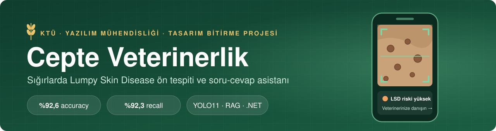
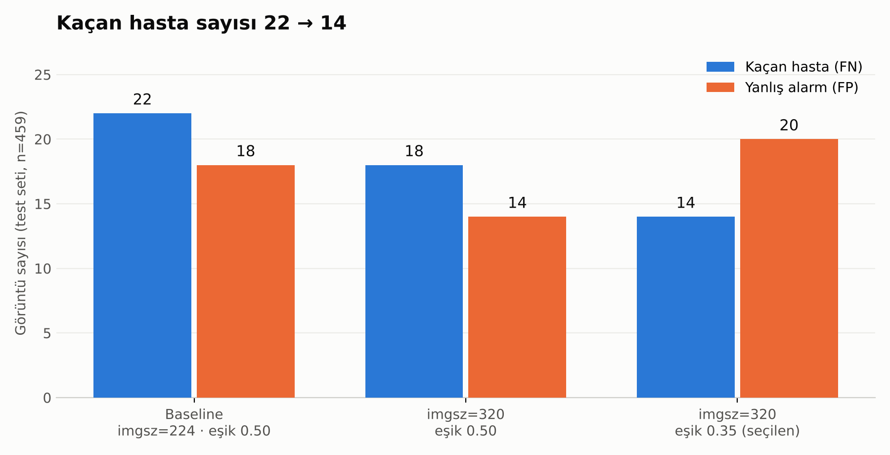
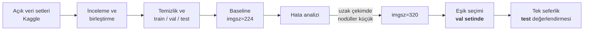
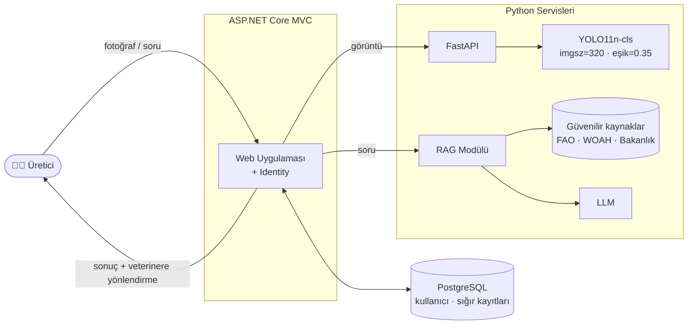
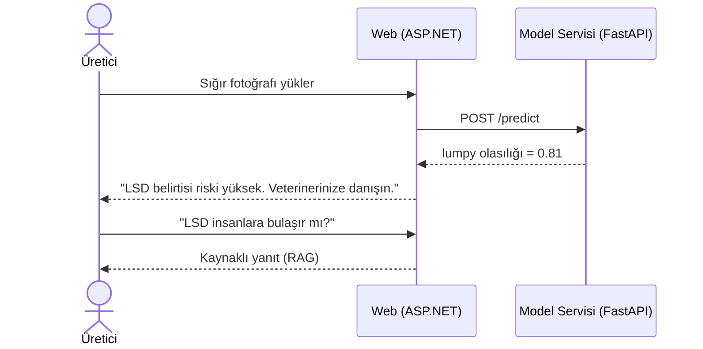

<p align="center">
  
</p>

<p align="center">
  
  
  
  
  
  
</p>

<p align="center">
  <a href="#-bir-bakışta">Bir Bakışta</a> ·
  <a href="#-problem">Problem</a> ·
  <a href="#-sonuçlar">Sonuçlar</a> ·
  <a href="#-yöntem">Yöntem</a> ·
  <a href="#-hata-analizi">Hata Analizi</a> ·
  <a href="#-model-kartı">Model Kartı</a> ·
  <a href="#️-mimari">Mimari</a> ·
  <a href="#️-yol-haritası">Yol Haritası</a>
</p>

---

## 🎯 Bir Bakışta

<table>
<tr>
<td align="center" width="25%"><h2>%92,6</h2><sub>Test accuracy<br>(hedef: ≥ %85)</sub></td>
<td align="center" width="25%"><h2>%92,3</h2><sub>LSD recall<br>(hastaları yakalama oranı)</sub></td>
<td align="center" width="25%"><h2>22 → 14</h2><sub>Kaçırılan hasta<br>(baseline → nihai model)</sub></td>
<td align="center" width="25%"><h2>459</h2><sub>Hiç görülmemiş<br>test görüntüsü</sub></td>
</tr>
</table>

**Cepte Veterinerlik**, üreticinin telefonla çektiği bir sığır fotoğrafından **Lumpy Skin Disease (LSD) belirtisi olup olmadığını** tahmin eden, hastalık hakkındaki sorularını **güvenilir kaynaklara dayanarak** yanıtlayan ve sürü kayıtlarını tutan bir web uygulamasıdır.

> [!IMPORTANT]
> **Sistem teşhis koymaz.** Bir ön değerlendirme aracıdır. Sonuç ne olursa olsun kullanıcıyı veterinere yönlendirir.

---

## 🌾 Neden Bu Proje?

Çiftçi bir ailede, hayvancılığın içinde büyüdüm. Sahada sık yaşanan bir sorun var: Hastalığın ilk belirtileri gözden kaçıyor, veterinere ulaşmak her zaman hızlı olmuyor ve bulaşıcı hastalıklarda geçen her gün sürünün geri kalanını riske atıyor.

Bu proje bu ihtiyaca yazılımla bir çözüm getirme denemesi. Amaç veterinerin yerini almak değil. Amaç, üreticinin **"bu hayvanı hemen veterinere göstermeliyim"** kararını daha erken verebilmesi.

---

## 📌 Problem

**Lumpy Skin Disease (Nodüler Ekzantem)**, sığırlarda görülen viral bir hastalıktır. Deride yaygın yumrular (nodüller), ateş, süt veriminde düşüş ve kalıcı deri hasarı yapar. Sinek, sivrisinek ve kene gibi vektörlerle (hastalığı taşıyan canlılar) yayılır. Bu nedenle erken fark edilmesi, hasta hayvanın ayrılması ve sürünün korunması açısından kritiktir.

### Bu problemde hatalar eşit değildir

| Hata türü | Ne olur? | Maliyeti |
|---|---|---|
| **Kaçan hasta** (False Negative) | Hasta hayvana "sağlıklı" denir | 🔴 **Yüksek:** Hastalık fark edilmez, sürüye yayılabilir |
| **Yanlış alarm** (False Positive) | Sağlıklı hayvana "riskli" denir | 🟡 **Düşük:** Gereksiz bir veteriner kontrolü yapılır |

Bu yüzden projenin temel başarı ölçütü yalnızca accuracy değil, **LSD sınıfının recall değeridir** (gerçek hastaların ne kadarının yakalandığı). Model ve eşik kararlarının tamamı bu önceliğe göre verilmiştir.

---

## 📊 Sonuçlar

Tüm sonuçlar, eğitimde ve model seçiminde **hiç kullanılmamış test seti** üzerinde ölçülmüştür (276 sağlıklı + 183 LSD = 459 görüntü).

| Deney | imgsz | Eşik | Accuracy | **LSD Recall** | Precision | Specificity | Kaçan | Y. Alarm |
|---|:---:|:---:|:---:|:---:|:---:|:---:|:---:|:---:|
| Baseline | 224 | 0.50 | 0.913 | 0.880 | 0.899 | 0.935 | 22 | 18 |
| Çözünürlük artışı | 320 | 0.50 | **0.930** | 0.902 | **0.922** | **0.949** | 18 | **14** |
| **Nihai model** ⭐ | **320** | **0.35** | 0.926 | **0.923** | 0.894 | 0.928 | **14** | 20 |

<p align="center">
  
</p>

<p align="center">
  
  <br><sub>Nihai model (YOLO11n-cls, imgsz=320, eşik=0.35) · test seti</sub>
</p>

**Takas açıkça seçildi:** Eşiği 0.50'den 0.35'e çekmek 4 hastayı daha yakaladı. Bunun bedeli 6 ek yanlış alarm ve accuracy'de 0,4 puanlık düşüş oldu. Yukarıdaki maliyet tablosu düşünüldüğünde bu takas bilinçli olarak tercih edildi.

---

## 🔬 Yöntem



<details>
<summary><b>1. Veri hazırlığı</b></summary>

- Kaggle üzerindeki açık LSD görüntü veri setleri incelendi ve birleştirildi.
- Veri temizlendi ve `healthy` / `lumpy` olarak iki sınıfa ayrıldı.
- Veri **train / val / test** olarak bölündü:
  - **val:** 276 sağlıklı, 182 LSD
  - **test:** 276 sağlıklı, 183 LSD
- Test seti, son değerlendirmeye kadar hiçbir karar aşamasında kullanılmadı.

</details>

<details>
<summary><b>2. Model ve eğitim</b></summary>

- **Model:** Ultralytics `YOLO11n-cls`. Görüntünün tamamını sınıflandıran, hafif ve hızlı bir model olduğu için ileride mobil ve sunucu tarafında kolayca çalıştırılabilir.
- **Ortam:** Google Colab, NVIDIA Tesla T4 GPU
- **Deney 1 (baseline):** `imgsz=224` (Ultralytics varsayılanı)
- **Deney 2:** `imgsz=320`. Bu deneyin gerekçesi baseline'ın hata analizinden çıktı (bkz. [Hata Analizi](#-hata-analizi)).

</details>

<details>
<summary><b>3. Eşik seçimi ve veri sızıntısının önlenmesi</b></summary>

Model her görüntü için 0 ile 1 arasında bir **LSD olasılığı** üretir. Varsayılan kural "olasılık ≥ 0.50 ise hasta" şeklindedir. Recall'u artırmak için daha düşük bir eşik arandı.

**Eşik test setine bakılarak seçilmedi.** Öyle yapılsaydı test seti "görülmemiş veri" olma özelliğini kaybeder ve sonuçlar olduğundan iyi görünürdü (*data leakage*, veri sızıntısı). Bunun yerine:

1. 0.50 ile 0.10 arasındaki eşikler **val setinde** tarandı.
2. Kaçan hasta sayısını belirgin biçimde azaltırken yanlış alarmı makul tutan **0.35** seçildi. 0.30 aynı recall'u daha fazla yanlış alarmla verdiği için elendi.
3. Seçilen eşik **test setine yalnızca bir kez** uygulandı.

| Eşik (val) | Recall | Precision | Accuracy | Kaçan | Y. Alarm |
|:---:|:---:|:---:|:---:|:---:|:---:|
| 0.50 | 0.940 | 0.950 | 0.956 | 11 | 9 |
| 0.40 | 0.945 | 0.940 | 0.954 | 10 | 11 |
| **0.35** | **0.956** | **0.921** | **0.950** | **8** | **15** |
| 0.30 | 0.956 | 0.911 | 0.945 | 8 | 17 |
| 0.20 | 0.962 | 0.902 | 0.943 | 7 | 19 |
| 0.10 | 0.978 | 0.873 | 0.934 | 4 | 26 |

> Val sonuçlarının testten biraz yüksek olması beklenen bir durumdur. Eğitim sırasında `best.pt` val skoruna göre seçildiği için val seti modele kısmen "tanıdık" gelir. Modelin gerçek başarısını test seti gösterir.

</details>

<details>
<summary><b>4. Kullanılan ölçütler</b></summary>

| Ölçüt | Soru | Formül |
|---|---|---|
| Accuracy | Tüm tahminlerin ne kadarı doğru? | (TP + TN) / Toplam |
| **Recall** | Gerçek hastaların ne kadarı yakalandı? | TP / (TP + FN) |
| Precision | "Hasta" denenlerin ne kadarı gerçekten hasta? | TP / (TP + FP) |
| Specificity | Sağlıklıların ne kadarı doğru bilindi? | TN / (TN + FP) |

</details>

---

## 🔎 Hata Analizi

Modelin yanlış bildiği görüntüler tek tek incelendi. Bu inceleme bir sonraki deneyin yönünü doğrudan belirledi:

| Bulgu | Gözlem | Yapılan / Planlanan |
|---|---|---|
| 📏 **Uzak çekim** | Kaçırılan örneklerin çoğu hayvanın tüm vücudunu gösteren uzak çekimlerdi. Nodüller 224 pikselde birkaç piksele düşüyordu. | ✅ `imgsz` 320'ye çıkarıldı: 7 hasta daha yakalandı |
| 🎨 **Renk kayması** | Lezyonların net göründüğü ama renk tonu kaymış yakın çekimler kaçırıldı. | 🔜 Renk augmentation'ı (eğitimde renk tonunu rastgele değiştirerek veri çoğaltma) |
| 🏷️ **Şüpheli etiketler** | Birden fazla hayvan içeren ya da belirti göstermeyen bazı "lumpy" etiketli görüntüler bulundu. | 🔜 Manuel etiket kontrolü |

<details>
<summary>Nihai modelin kaçırdığı görüntüler</summary>
<br>

</details>

---

## 🪪 Model Kartı

| | |
|---|---|
| **Model** | YOLO11n-cls · imgsz=320 · karar eşiği 0.35 |
| **Görev** | İkili görüntü sınıflandırma: `healthy` / `lumpy` |
| **Amaçlanan kullanım** | Üreticiye ön değerlendirme sunmak ve veterinere başvuruyu hızlandırmak |
| **Amaçlanmayan kullanım** | Kesin teşhis, tedavi kararı, resmî bildirim yerine geçmek |
| **Eğitim verisi** | Kaggle üzerindeki açık LSD görüntü veri setleri |

**Bilinen kısıtlar**
- Model, görüntünün **tamamı** hakkında karar verir. Lezyonun yerini göstermez.
- Veri setindeki görüntülerin önemli bir kısmı Güney Asya'daki sığır ırklarına aittir. Türkiye'de yaygın olan ırklarda (Holstein, Simental, yerli ırklar) performansın **saha verisiyle ayrıca doğrulanması** gerekir.
- LSD dışındaki deri hastalıkları (örneğin mantar enfeksiyonları) eğitimde ayrı bir sınıf olarak yer almadığı için yanlış alarmlara yol açabilir.
- Düşük ışık, bulanıklık ve çok uzak çekim performansı düşürür.

---

## 🏗️ Mimari



**Kullanıcı akışı**



---

## 🧪 Deney Günlüğü

| # | Notebook | Ne yapıldı? | Çıkan sonuç |
|---|---|---|---|
| 01 | `01_veri_incelem.ipynb` | Veri setinin keşifsel analizi | Sınıf dağılımı ve görüntü kalitesi incelendi |
| 02 | `02_ikinci_veri_seti.ipynb` | Ek veri seti incelemesi | Veri çeşitliliği artırıldı |
| 03 | `03_kaggle_veri_seti.ipynb` | Kaggle veri setinin entegrasyonu | Veriler tek yapıda birleştirildi |
| 04 | `04_temizlik_ve_bolme.ipynb` | Temizlik, train / val / test bölmesi | Değerlendirmeye hazır veri seti oluşturuldu |
| 05 | `05_ilk_egitim.ipynb` | Baseline eğitimi (imgsz=224) | Test recall 0.880 |
| 06 | `06_deney_imgsz320.ipynb` | Çözünürlük deneyi ve hata analizi | Test recall 0.902 |
| 07 | `07_test_degerlendirme.ipynb` | Model karşılaştırması, eşik seçimi, hata analizi | **Test recall 0.923** |

---

## 🛠️ Teknolojiler

| Katman | Teknoloji |
|---|---|
| Görüntü modeli | Python · Ultralytics YOLO11 · Google Colab (T4 GPU) |
| Değerlendirme | scikit-learn · NumPy · Matplotlib |
| Model servisi | FastAPI |
| Soru-cevap | RAG (Retrieval-Augmented Generation) + LLM |
| Web uygulaması | C# · ASP.NET Core MVC · ASP.NET Core Identity |
| Veritabanı | PostgreSQL |

---

## 📁 Proje Yapısı

```
cepte-vet/
├── notebooks/              # 01–07: veri, eğitim ve değerlendirme
├── docs/
│   └── images/             # banner, grafikler, confusion matrix, hata analizi
└── README.md
```

---

## 🗺️ Yol Haritası

**Faz 1: Görüntü modeli** ✅
- [x] Veri setlerinin toplanması, temizlenmesi ve bölünmesi
- [x] Baseline eğitimi ve hata analizi
- [x] Çözünürlük deneyi (224 → 320)
- [x] Val setinde eşik seçimi, test setinde nihai değerlendirme

**Faz 2: Modelin iyileştirilmesi** 🔄
- [ ] Şüpheli etiketlerin manuel kontrolü
- [ ] `imgsz=448` ve renk augmentation deneyleri

**Faz 3: Uygulama** 🔜
- [ ] FastAPI model servisi (`/predict`)
- [ ] ASP.NET Core MVC web uygulaması ve Identity
- [ ] Sığır kayıt takibi: aşı, hastalık, doğum
- [ ] RAG soru-cevap asistanı ve 20–30 soruluk değerlendirme seti

**Faz 4: Saha doğrulaması** 🔜
- [ ] 3–5 üretici ile kullanıcı testi

**Gelecek çalışmalar:** Şap (FMD) ve pembe göz (IBK) ile çok sınıflı modele genişleme · mobil uygulama

---

## ⚖️ Sorumlu Yapay Zekâ

- Model çıktısı her zaman bir **olasılık ve uyarı metniyle** birlikte gösterilir, kesin bir hüküm olarak sunulmaz.
- Soru-cevap modülü yalnızca **belirlenmiş güvenilir kaynaklardan** yanıt üretecek şekilde tasarlanır ve kaynağını gösterir.
- Eşik, **hasta kaçırmayı en aza indirecek** şekilde seçilmiştir. Belirsiz durumlarda sistem veterinere yönlendirme tarafında kalır.

---

## 📚 Kaynaklar ve Benzer Çalışmalar

- *Early Detection of Lumpy Skin Disease in Cattle Using Deep Learning*: [PMC11512320](https://pmc.ncbi.nlm.nih.gov/articles/PMC11512320/)
- *AI-powered visual E-monitoring system for cattle health and wealth*
- [Ultralytics YOLO11 dokümantasyonu](https://docs.ultralytics.com/)

---

## 👤 Geliştirici

<table>
<tr>
<td>
<b>Enes Kok</b><br>
Karadeniz Teknik Üniversitesi, Yazılım Mühendisliği<br><br>
<a href="https://github.com/EnesKok20"></a>
<a href="https://linkedin.com/in/enes-kok-56187b296"></a>
</td>
</tr>
</table>

<p align="center"><sub>Sahadaki gerçek bir ihtiyaçtan doğdu. 🌾</sub></p>
